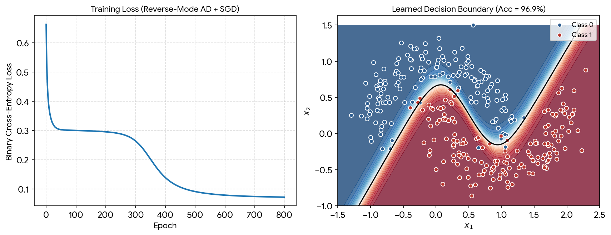

# Reverse-Mode Automatic Differentiation Engine for Neural Networks

A lightweight, from-scratch **reverse-mode automatic differentiation (autograd)** engine implemented in pure Python/NumPy without deep learning frameworks. Builds dynamic computation graphs over 2D tensors, propagates adjoints via reverse topological sort, and validates analytical gradients against central finite differences.

## Mathematical Formulation

Given a scalar loss $L(\theta) = \ell(f_\theta(x), t)$, reverse-mode AD initializes the output adjoint $\bar{L} = \frac{\partial L}{\partial L} = 1$ and propagates vector–Jacobian products backward through each primitive operator:

- **Matrix Multiplication** ($Y = XW$): $\bar{X} \mathrel{+}= \bar{Y} W^\top$, $\bar{W} \mathrel{+}= X^\top \bar{Y}$
- **Broadcasted Addition** ($Y = X + b$): $\bar{b} \mathrel{+}= \sum_{\text{batch}} \bar{Y}$
- **Elementwise Nonlinearity** ($Y = \tanh(X)$): $\bar{X} \mathrel{+}= (1 - Y^2) \odot \bar{Y}$
- **Logit Binary Cross-Entropy** ($L = \frac{1}{m}\sum [\max(z,0) - zt + \log(1+e^{-|z|})]$): $\bar{z} = \frac{1}{m}(\sigma(z) - t)$

## Verification & Training Benchmark

| Evaluation Metric | Result | Notes |
| :--- | :---: | :--- |
| Max Absolute Gradient Error ($\epsilon = 10^{-6}$) | **`9.085e-11`** | Central finite-difference check across all MLP layers |
| Max Relative Gradient Error ($\epsilon = 10^{-6}$) | **`1.715e-09`** | Confirms exact chain-rule & unbroadcasting implementation |
| Training BCE Loss (Epoch 0 $\to$ 800) | `0.6631` $\to$ **`0.0720`** | 3-layer MLP (`[2, 24, 24, 1]`) trained with vanilla SGD |
| Classification Accuracy (Two-Moons) | **`96.88%`** | Non-linear decision boundary on noisy dataset ($\sigma = 0.18$) |



## Usage

```bash
pip install -r requirements.txt
python autograd_nn.py
```
